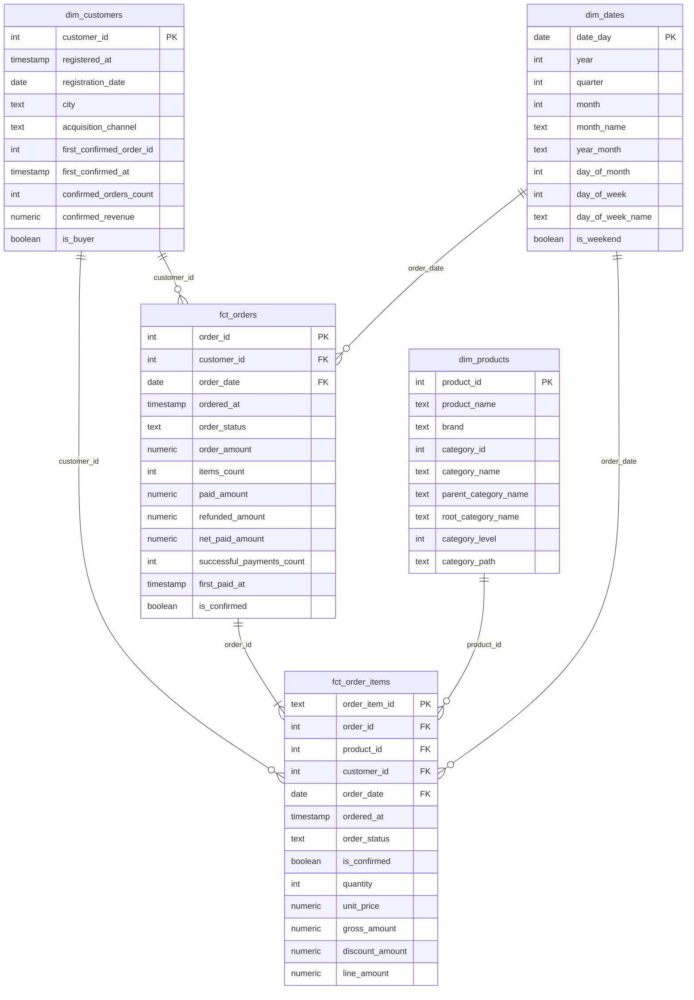
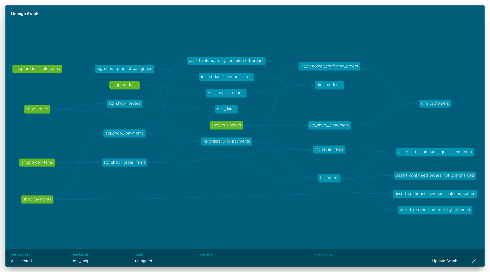

# store_hse

Аналитический слой интернет-магазина на dbt в хранилище Greenplum: витрины по схеме «звезда».

```
PostgreSQL (OLTP, shop.public) ── loader ──► Greenplum dwh.raw ── dbt ──► analytics_staging
                                                                           analytics_intermediate
                                                                           analytics_marts
```

## Запуск

```bash
docker compose down -v && docker compose up -d   # чистые базы и загрузка raw
docker compose logs loader                       # ждём строку «Готово»
docker compose run --rm dbt build                # ERROR=0, WARN=1 (объяснён ниже)
```

Документация и граф lineage:

```bash
docker compose run --rm dbt docs generate
docker compose run --rm --service-ports dbt docs serve --host 0.0.0.0 --port 8080
```

После этого открыть http://localhost:8080.

## Модель данных



### Витрины

| Витрина | Зернистость | На какой вопрос отвечает |
|---|---|---|
| `fct_orders` | один заказ (без тестовых) | Сколько заказов и выручки, средний чек по городам (с `dim_customers`), сколько оплачено и возвращено |
| `fct_order_items` | один товар в заказе | Выручка по месяцам и категориям (с `dim_dates` и `dim_products`), какие бренды чаще возвращают (`order_status = 'returned'`) |
| `dim_customers` | один клиент, включая не купивших | Доля покупателей по каналам привлечения (`is_buyer`), когда была первая покупка, сколько клиент принёс |
| `dim_products` | один товар | Группировка по бренду и по уровням категорий: категория, родитель, верхний уровень (Electronics / Home) |
| `dim_dates` | один день от первой до последней даты заказа | Отчёты по дням, месяцам, кварталам, будни и выходные; дни без заказов тоже есть в календаре |

Подтверждённая покупка — заказ со статусом `paid` и хотя бы одной успешной оплатой (возврат оплатой не считается). Определение лежит в doc-блоке `confirmed_order` в `models/docs.md`.

### Хранение в Greenplum

| Витрина | Распределение | Тип таблицы | Почему |
|---|---|---|---|
| `fct_orders` | `distributed by (order_id)` | heap | Тот же ключ, что у `raw.orders`, `raw.order_items`, `raw.payments` и `fct_order_items`, поэтому сборка витрины и соединение с позициями по `order_id` идут локально на каждом сегменте. `order_id` уникален, строки ложатся по сегментам равномерно. |
| `fct_order_items` | `distributed by (order_id)` | колоночная append-optimized | Самый большой и широкий факт, а отчёты читают из него 2–3 столбца (`line_amount`, `product_id`, `order_date`); колоночная таблица читает с диска только их. Ключ `order_id`, а не `order_item_id` или `product_id`, — чтобы соединение с `fct_orders` шло без пересылки строк. По `product_id` распределять нельзя: всего 13 товаров, будет перекос. |
| `dim_customers` | `distributed by (customer_id)` | heap | Клиентов становится больше вместе с бизнесом, держать полную копию на каждом сегменте со временем дорого. `customer_id` уникален, распределение равномерное. |
| `dim_products` | `distributed replicated` | heap | 13 строк и растёт медленно. Копия на каждом сегменте: соединение с `fct_order_items` по `product_id` идёт без пересылки строк. |
| `dim_dates` | `distributed replicated` | heap | 133 строки, за год прибавляется 365. Так же, как товары: соединение по дате без пересылки строк. |

Почему ключи фактов одинаковые. Сырые `raw.orders`, `raw.order_items` и `raw.payments` уже распределены по `order_id` (см. `init/greenplum/load_raw.sql`). Если `fct_orders` и `fct_order_items` тоже лежат по `order_id`, то заказ и все его позиции находятся на одном сегменте, и `join ... on order_id` выполняется на каждом сегменте отдельно. Если бы ключи были разными (например, `fct_order_items` по `order_item_id`), Greenplum при каждом таком запросе пересылал бы одну из таблиц по сети между сегментами: в плане появилась бы `Redistribute Motion` или `Broadcast Motion`, и запрос стал бы заметно медленнее на больших данных.

Проверить, что получилось:

```sql
select c.relname, pg_get_table_distributedby(c.oid) as distribution, am.amname as storage
from pg_class c
join pg_namespace n on n.oid = c.relnamespace
left join pg_am am on am.oid = c.relam
where n.nspname = 'analytics_marts' and c.relkind = 'r';
```

### Lineage



## Слои

| Слой | Схема | Модели |
|---|---|---|
| staging (view) | `analytics_staging` | `stg_shop__customers`, `stg_shop__orders`, `stg_shop__order_items`, `stg_shop__payments`, `stg_shop__products`, `stg_shop__product_categories` |
| intermediate (view) | `analytics_intermediate` | `int_orders_with_payments` — заказ + итоги платежей и число товаров; `int_product_categories_tree` — дерево категорий рекурсивным CTE; `int_customer_confirmed_orders` — итоги покупок по клиенту |
| marts (table) | `analytics_marts` | `fct_orders`, `fct_order_items` (incremental), `dim_customers`, `dim_products`, `dim_dates` |

## Тесты

- `unique` и `not_null` на первичный ключ каждой модели staging и marts.
- `relationships` от внешних ключей фактов к измерениям: `fct_order_items` → `dim_products`, `dim_customers`, `dim_dates`, `fct_orders`; `fct_orders` → `dim_customers`, `dim_dates`.
- `accepted_values` на статусы заказа и платежа. В staging у заказа есть статус `test`, в `fct_orders` и `fct_order_items` его уже быть не должно.
- Свой generic-тест `non_negative` (`tests/generic/non_negative.sql`) — на суммы, цены, количества.
- Singular-тесты в `tests/`:

| Тест | Что проверяет |
|---|---|
| `assert_order_amount_equals_items_sum` | Сумма заказа в `fct_orders` равна сумме `line_amount` его позиций |
| `assert_confirmed_revenue_matches_source` | Число и сумма подтверждённых покупок в `fct_orders` совпадают с посчитанными прямо по `source('shop', 'orders')` и `source('shop', 'payments')` |
| `assert_returned_orders_fully_refunded` | По возвращённому заказу `net_paid_amount = 0` |
| `assert_confirmed_orders_not_overcharged` | Подтверждённому заказу не списали больше его суммы (severity `warn`) |
| `assert_refunds_only_for_returned_orders` | Возврат бывает только у заказа со статусом `returned` (с семинара) |

### Что нашёл тест `assert_confirmed_orders_not_overcharged` (WARN)

Заказ **113** (клиент 7): сумма заказа 200, но прошло два успешных списания по 200 — платежи 1015 и 1016 с разницей в минуту. Это двойное списание: клиент заплатил 400 вместо 200, лишние 200 нужно вернуть. Данные мы не правим и тест под них не подгоняем, поэтому у него severity `warn`: `dbt build` проходит, но проблема видна. Строку с ошибкой можно посмотреть в `analytics_dbt_test__audit.assert_confirmed_orders_not_overcharged`. На выручку это не влияет: в витринах выручка считается по сумме заказа, а не по сумме списаний.

## Дополнительное задание: инкрементальная `fct_order_items`

`fct_order_items` собрана как `materialized='incremental'` с `unique_key='order_item_id'`. При повторном запуске модель берёт только заказы, у которых `ordered_at` не раньше последнего уже загруженного (`ordered_at >= max(ordered_at)`), и обновляет их позиции по ключу (delete + insert). Первая сборка, в том числе после `docker compose down -v`, строит таблицу целиком.

Что такая модель пропустит:

1. **Изменение статуса старого заказа.** Заказ был `pending`, потом стал `paid` или `returned`, либо пришла оплата по старому заказу. В `fct_orders` (обычная таблица, пересобирается полностью) статус и `is_confirmed` обновятся, а в `fct_order_items` останутся старыми. Два факта начнут расходиться.
2. **Правку позиций старого заказа**: поменяли количество, цену или скидку, добавили или убрали товар. Проверено: если поменять скидку в заказе 101, обычный запуск изменения не видит, тест на сумму заказа становится красным только после `--full-refresh`.
3. **Удаление строк в источнике.** Инкрементальная модель только добавляет и обновляет, удалённые позиции остаются в витрине.
4. **Поздно пришедшие заказы**, у которых `ordered_at` раньше максимального в витрине (например, заказ загрузили с опозданием).

Как с этим жить: периодически пересобирать модель целиком (`dbt build -s fct_order_items --full-refresh`) или обрабатывать окно последних нескольких дней. Совсем правильно — иметь в источнике колонку `updated_at` и выбирать новые строки по ней.
